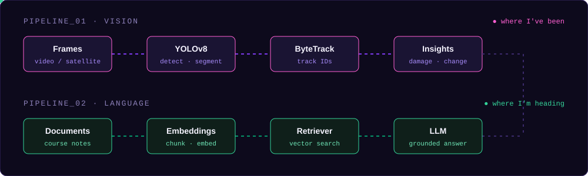

<!-- ================= HERO ================= -->

  

  

  <a href="#whoami"><b>[ 👩‍💻 whoami ]</b></a> •
  <a href="#pipelines"><b>[ 🧠 Pipelines ]</b></a> •
  <a href="#experience"><b>[ 🏢 Experience ]</b></a> •
  <a href="#tech-stack"><b>[ 🛠️ Tech Stack ]</b></a> •
  <a href="#projects"><b>[ 💎 Projects ]</b></a> •
  <a href="#github-stats"><b>[ 📊 Stats ]</b></a> •
  <a href="#connect"><b>[ 📡 Connect ]</b></a>

---

## 👩‍💻 whoami

  

<table>
<tr>
<td width="50%" valign="top">

### 🎯 Profile
🎓 **Education:** Computer Engineering — Bilecik Şeyh Edebali University 
🧠 **Focus:** Computer Vision → Large Language Models 
📍 **Location:** Istanbul, Türkiye 
🔎 **Looking for:** Spring 2027 long-term internship in AI / ML

</td>
<td width="50%" valign="top">

### 📚 Programs & Certificates
🏅 **YÖK Data Analysis School** — AI & Machine Learning module (2025–2026) 
☀️ **Coderspace** — Data Science & AI Summer School (2026, 48h) 
💻 **Self-study:** Python, ML, Deep Learning, LangChain & RAG 
🌱 **Habit:** one small commit every day

</td>
</tr>
</table>

---

## 🧠 Pipelines

I started with **computer vision** — detecting, tracking and segmenting things in images and video.
Now I'm moving toward **language models**, building retrieval-augmented systems on top of what I've learned.

  

---

## 🏢 Experience

| Period | Company | Role | What I did |
|:--|:--|:--|:--|
| **Summer 2026** | **İSBAK** | Intern | Built personal projects around intelligent transportation (incl. a smart intersection prototype); got hands-on exposure to how edge AI hardware is used in the field |
| **Aug 2025** | **Enoca** | Backend Developer Intern | Developed REST APIs with **Spring Boot** and secured them with **JWT** authentication |

---

## 🛠️ Tech Stack

| Domain | Technologies |
|:--|:--|
| **🧠 AI / ML** | `Python` `YOLOv8` `ByteTrack` `Roboflow` `Instance Segmentation` `Object Tracking` |
| **💬 LLM** | `LangChain` `RAG` `Embeddings` `Vector Search` |
| **⚙️ Backend** | `Java` `Spring Boot` `REST APIs` `JWT` |
| **🎮 Game Dev** | `Unity` `C#` |
| **🔌 Embedded** | `C` `STM32F4` |
| **🔧 Tools** | `Git` `GitHub` `VS Code` `PyCharm` `Visual Studio` |

  

---

## 💎 Projects

<table>
<tr>
<td width="50%" valign="top">

### 🛣️ [Road Damage Detection — Edge AI](https://github.com/esra-yasar/Road-Damage-Detection-Edge-AI)
Detects and tracks road damage such as cracks and potholes in video, giving each defect a persistent ID across frames.

`YOLOv8` • `ByteTrack` • `Python`

</td>
<td width="50%" valign="top">

### 🛰️ [Bilecik Building Segmentation](https://github.com/esra-yasar/bilecik-building-segmentation)
Building change detection on satellite imagery of Bilecik. I collected the images from Google Earth and hand-annotated every mask in Roboflow.

`YOLOv8s-seg` • `Roboflow` • `Python`

</td>
</tr>
<tr>
<td width="50%" valign="top">

### 🧪 [llm-rag-lab](https://github.com/esra-yasar/llm-rag-lab)
My daily learning lab for LLMs — experiments with prompts, chains, embeddings and retrieval, committed as I go.

`LangChain` • `RAG` • `Python`

</td>
<td width="50%" valign="top">

### 📘 [CourseMind](https://github.com/esra-yasar/coursemind) 🚧 in progress
An LLM assistant that helps with my own university courses by answering questions grounded in course material.

`LLM` • `RAG` • `Python`

</td>
</tr>
<tr>
<td width="50%" valign="top">

### 🚦 Smart Intersection 🔜 coming soon
A traffic intersection project I built during my İSBAK internship.

`Computer Vision` • `Python`

</td>
<td width="50%" valign="top">

### 🏨 Son Misafir 🚧 in development
A horror game set in a hotel full of wizards. It uses facial analysis to guess what scares the player.

`Unity` • `C#` • `AI`

</td>
</tr>
</table>

---

## 📊 GitHub Stats

  
  

  

  

---

## 📡 Connect

  
  

  

  

